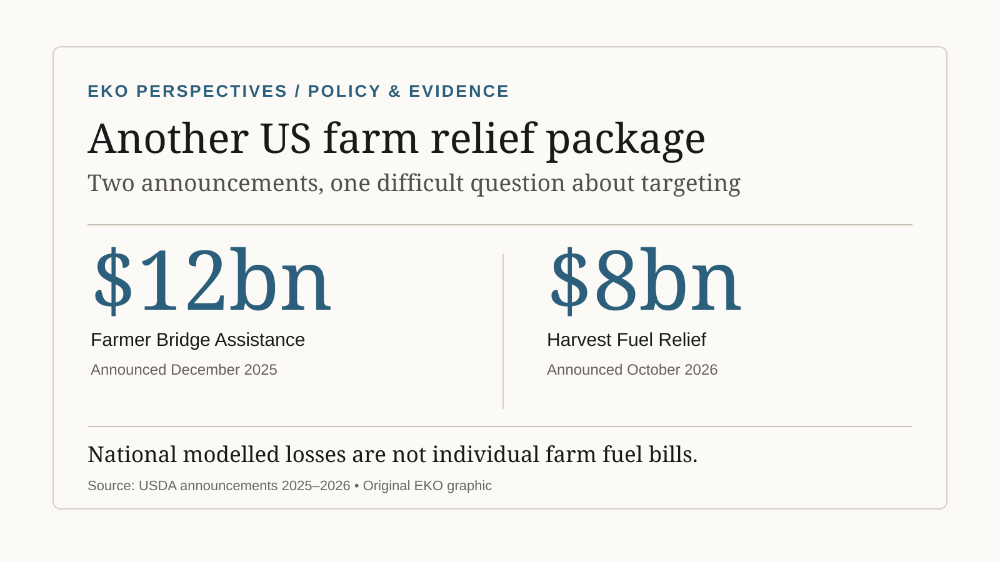

# Trump’s \$8 billion farm relief plan: why farmers need more than another payment

Policy

Economics & Evidence

USDA has announced \$8 billion in Harvest Fuel Relief, following \$12 billion in earlier farm assistance. How will payments work, who benefits, and what problems remain?

Author

Elvis Kwame Ofori

Published

20 October 2026

Two US farm-relief programmes announced in less than a year, each using national modelling rather than farm-specific reimbursement.

*Graphic: EKO Perspectives, based on [USDA’s 19 October announcement](https://www.usda.gov/about-usda/news/press-releases/2026/10/19/trump-administration-announces-8-billion-harvest-fuel-relief-program) and the [December 2025 Farmer Bridge Assistance announcement](https://www.fsa.usda.gov/news-events/news/12-10-2025/trump-administration-announces-12-billion-farmer-bridge-payments). The figures represent separate announced packages, not a measure of outstanding or unpaid assistance.*

Washington has announced another **\$8 billion** in one-time assistance for American farmers. The **Harvest Fuel Relief Program**, announced on 19 October by President Donald Trump and Agriculture Secretary Brooke Rollins, is intended to help producers facing increased input costs and market disruption. It follows the **\$12 billion Farmer Bridge Assistance** package announced in December 2025. Together they represent \$20 billion in announced assistance under separate programmes, not \$20 billion still awaiting disbursement. USDA says the earlier programme has already delivered payments.

The assistance addresses a genuine economic problem. What deserves closer examination is how payments will be calculated, which farms will benefit, and why another exceptional intervention has been announced less than a year after the previous one.

According to the [USDA release](https://www.usda.gov/about-usda/news/press-releases/2026/10/19/trump-administration-announces-8-billion-harvest-fuel-relief-program), the new programme will be administered by the Farm Service Agency under the Commodity Credit Corporation Charter Act. Its uniform formula estimates a share of crop-year losses using reported planted acreage, production costs and projected yields and prices. That is different from reimbursing what each farm actually spent on diesel.

## What will the \$8 billion programme pay for?

The name suggests fuel compensation, but the calculation is broader. USDA intends to use Farm Service Agency acreage records, Economic Research Service cost estimates and World Agricultural Supply and Demand Estimates to determine payments for the 2026 crop year.

For **Title I commodities**, payment rates are scheduled for release in **November 2026**. Methodology for other eligible commodities has not yet been announced. Producers of non-Title I commodities, including specialty crop growers and fishermen, have been invited to send evidence of higher fuel costs to USDA. Crop-insurance participation is not required, and USDA has encouraged producers to arrange a Login.gov account ahead of applications. Those are the [announced arrangements](https://www.usda.gov/about-usda/news/press-releases/2026/10/19/trump-administration-announces-8-billion-harvest-fuel-relief-program), not a final list of individual entitlements.

A national formula can make assistance easier to administer. The government already collects acreage information and produces commodity forecasts. But there is a difference between estimating losses for a crop nationally and measuring the financial position of a particular farm.

Consider two growers planting the same acreage of corn. One operates relatively efficient machinery on contiguous fields. Another works fragmented land and depends on contractors whose charges rise with diesel prices. Their costs may diverge sharply even when the model assigns the same commodity rate per acre. The example is illustrative, not a calculation of actual payments under rules that have not yet been released.

A formula based on average crop losses can provide meaningful relief without closely matching the losses it is supposed to cushion. That limitation is not necessarily a reason to abandon it. It is a reason to describe what the programme actually compensates.

## Why is another payment necessary?

Fuel is particularly difficult to avoid at harvest. Tractors, combines, dryers, haulage and purchased services all expose farming businesses to energy costs, directly or indirectly. A farmer who committed to a crop months earlier cannot simply undo that decision when the cost of bringing it to market changes.

The conflict involving Iran has contributed to volatility in energy markets. Trade restrictions and retaliation can separately affect agricultural export opportunities and prices. These pressures should not be collapsed into a single explanation for every difficulty facing US agriculture.

Some vulnerabilities are older than either shock. Crop prices move through global supply cycles, and strong production can coincide with weak prices received by growers. Debt, land tenure, labour costs and access to markets also differ substantially among farms. An emergency payment may improve liquidity without changing those underlying conditions.

The [USDA Economic Research Service’s farm-income outlook](https://www.ers.usda.gov/topics/farm-economy/farm-sector-income-finances/highlights-from-the-farm-income-forecast) also cautions against treating the farm sector as uniformly distressed. Its May 2026 forecast anticipated a modest decline in net farm income while still placing sector-wide profits above their inflation-adjusted twenty-year average. This aggregate can coexist with serious financial pressure in particular commodities, regions and highly indebted operations. The distribution matters as much as the national total.

## The earlier \$12 billion package provides a useful test

The December 2025 Farmer Bridge Assistance announcement allocated up to **\$11 billion** to eligible row-crop producers and **\$1 billion** to other commodities. It was also designed around a national loss model rather than each farm’s verified additional expenses.

By the end of December, USDA had published crop-specific rates. Eligible rice acreage attracted **\$132.89 per acre**, cotton **\$117.35**, wheat **\$39.35** and soybeans **\$30.88**. These differences followed commodity loss calculations, not measurements of diesel expenses on individual farms. The figures are recorded in the [Farm Service Agency’s payment announcement](https://www.fsa.usda.gov/news-events/news/12-31-2025/usda-announces-commodity-payment-rates-farmer-bridge-assistance-program).

The earlier programme is not merely an announced sum waiting in Washington. USDA stated in its 19 October release that it had delivered the \$12 billion package to more than 560,000 farmers. Its [Farmer Bridge Assistance programme page](https://www.fsa.usda.gov/resources/income-support/farmer-bridge-assistance-fba-program) also provides payment information and a dashboard.

What it offers is evidence of the administration’s chosen mechanism. Payment depends heavily on commodity and reported area. That may be transparent and rapid, but it need not be closely related to the severity of financial distress within a commodity. A farm’s payment and its operating margin are different quantities.

## Relief is defensible. The allocation still needs scrutiny

There is a substantial case for temporary farm support when producers face abrupt shocks after committing capital to a season. A farm cannot freely adjust planted area or machinery investment in the middle of harvest. Timely assistance may prevent a liquidity problem from becoming a debt crisis, or keep a viable business from selling productive assets during an exceptional year.

The government’s use of a standardised formula also has advantages. Trying to reconstruct a farm-by-farm counterfactual for fuel spending would be costly, difficult to verify and slow. Administrative simplicity is not an empty virtue when assistance is time-sensitive.

But the compromise creates distributional questions. Acreage is not a measure of household income. A national modelled loss is not an individual audited loss. Farms with the same planted area can have different borrowing costs, labour arrangements and energy exposure. Payment limits and eligibility rules can further change who receives support.

The timing is important too. Announcing an \$8 billion envelope does not immediately improve a farmer’s cash balance. Payment rates for Title I crops are not due until November, and the timetable and methodology for other commodities are still being developed. Producers cannot yet treat a proposed national sum as a known farm-level receipt.

There is a deeper policy tension here. The Commodity Credit Corporation gives USDA flexibility to respond without seeking new legislation for each intervention. That capacity is valuable during a genuine crisis, but repeated exceptional payments can become part of the expected farm-income system. The immediate programme may be successful at cash-flow relief while leaving the underlying exposure essentially unchanged.

## Beyond the next payment

The two packages respond to different production years and pressures, so it would be misleading to say that the second simply replaces the first. Nor does repeated relief by itself prove that the government caused the losses being compensated. The role of tariffs, international conflict, market structure and ordinary commodity cycles needs to be established rather than asserted.

It is still reasonable to ask whether public policy could reduce some of the instability that eventually appears on the expenditure side of the federal budget. More predictable trading relationships, competitive input markets, workable risk-management tools and investment in farm productivity can matter alongside direct income support. They operate on different time horizons, and none eliminates the case for emergency protection.

The Harvest Fuel Relief Program may help farmers through an expensive season. Its results should eventually be assessed by the distribution and timing of actual payments and by whether they meaningfully offset cash-flow pressures, not just by the size of the announcement.

For now, Washington has pledged another \$8 billion. The farm-level calculation is still incomplete. A public payment can ease a difficult harvest; it cannot, on its own, establish whether the business conditions producing recurring demands for relief have improved.
