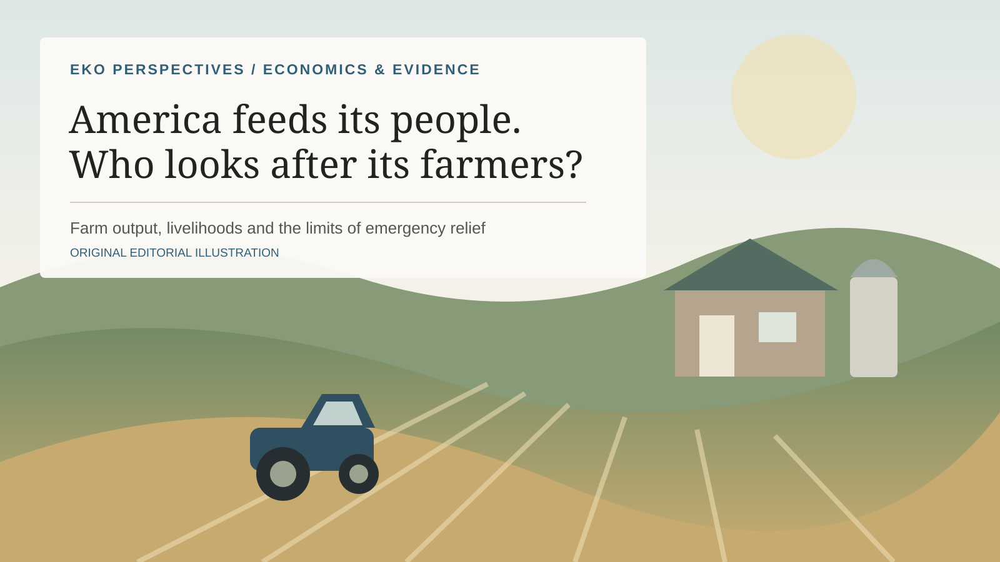

# America feeds its people. But who is looking after its farmers?

Economics & Evidence

Policy

The US spends billions on farm relief, yet farming households face very different margins and risks. What should agricultural assistance actually protect?

Author

Elvis Kwame Ofori

Published

21 October 2026

American agriculture generates substantial national income, but the financial position of farming households varies considerably.

*Graphic: EKO Perspectives. For farm-income definitions and the latest forecast, see the [USDA Economic Research Service](https://www.ers.usda.gov/topics/farm-economy/farm-sector-income-finances/highlights-from-the-farm-income-forecast).*

Washington has announced another \$8 billion in assistance for American farmers, less than a year after promising \$12 billion under the Farmer Bridge Assistance programme. The latest package, called Harvest Fuel Relief, is intended to help producers facing higher fuel costs and difficult market conditions. The money is welcome, particularly for farmers already operating on narrow margins. But two multibillion-dollar interventions in such a short period ought to make us think more carefully about the financial conditions under which American food is produced. [USDA described the new programme on 19 October](https://www.usda.gov/about-usda/news/press-releases/2026/10/19/trump-administration-announces-8-billion-harvest-fuel-relief-program).

There is something uncomfortable about a country capable of producing food on such an extraordinary scale having to repeatedly rescue the businesses responsible for growing it. Farming has always been risky. Weather, disease and commodity prices can undermine even the most careful investment decisions. No government can remove those uncertainties. But neither should emergency payments become a substitute for understanding why some farms struggle to remain financially viable.

[USDA’s farm-income forecasts](https://www.ers.usda.gov/topics/farm-economy/farm-sector-income-finances/highlights-from-the-farm-income-forecast) describe a sector generating substantial national income while the median household earns little or even negative net income directly from farming. Many farm households depend primarily on work outside agriculture. These measures are not directly comparable: a large commercial farm is not economically comparable to a small holding maintained alongside another occupation. Still, the contrast tells us something important. Strong national agricultural performance does not mean that the people operating farms are all doing well.

## What should farm assistance actually compensate?

Agricultural economist [Matthew Gammans](https://lnkd.in/g8i3w8hD) recently examined three possible ways to distribute the new \$8 billion: using an updated version of the earlier Farmer Bridge formula, compensating national average fuel spending by crop, or adjusting fuel expenditure by region.

His illustrative calculations produce considerably different outcomes. Wheat receives an estimated \$36.89 per acre under the first approach but only \$16.32 under the national fuel-spending formula. Corn and soybeans receive larger payments under the fuel-based calculation. These are modelled scenarios, not the payment rates USDA has announced.

What interests me is not which crop receives the largest payment. It is how much the meaning of assistance changes when the formula changes.

A farmer growing wheat in Kansas does not necessarily face the same costs as a farmer growing wheat elsewhere. Machinery requirements, field conditions, transport distances and regional prices influence what remains after production expenses are paid. Two farms with similar acreage may have very different margins, especially when one carries substantial debt or rents most of its land.

A national formula makes administration easier. It may also be the quickest way to deliver money when farmers need it. But it cannot fully recognise these differences. Regional payments could improve the fit between compensation and particular costs, although they introduce their own measurement problems.

And more precise payments do not necessarily mean farmers retain more money. Research discussed in a [2015 *farmdoc daily* article](https://farmdocdaily.illinois.edu/2015/05/influence-of-direct-payments-on-us-cropland-values.html) found that agricultural support can be reflected in higher farmland values. Where benefits are capitalised into land prices and rents, some of the gains may eventually accrue to landowners rather than the producers the policy intended to help.

This is why I think we should be cautious about measuring agricultural support by the billions announced. The more revealing figures concern who receives the payments, how much they retain, and whether their financial position improves.

## The people producing food deserve a larger conversation

Abraham Maslow placed food among humanity’s most basic physiological needs. His theory has limitations, but the underlying observation is difficult to dispute. Food is not a luxury we can postpone until economic conditions improve. Every household depends on it.

Yet the public conversation about food often centres on grocery prices, inflation, trade disputes and government spending. Those are legitimate concerns. I wonder whether we give comparable attention to the livelihoods of the people producing it.

Farmers are not absent from American politics. Farm organisations [testify before Congress](https://www.agriculture.senate.gov/hearings) and represent producers in negotiations with government. But American agriculture is hardly one uniform constituency. A large grain producer, a tenant farmer, a small livestock operation and a young person trying to acquire land may have very different interests.

Whose difficulties are most visible when agricultural organisations speak for farmers? Whose losses are reflected in national models? And what happens to producers whose problems are not adequately captured by acreage, commodity prices or average costs?

These questions matter because food security depends on more than achieving another record harvest. It also depends on the capacity of farms to survive difficult periods, maintain productive assets and attract another generation into agriculture.

There is a legitimate case for emergency support. Farmers commit substantial resources long before knowing the prices they will receive. A sudden increase in diesel costs can turn a reasonable production decision into a financial problem that cannot be corrected before harvest. Timely assistance may keep a viable farm operating.

But compensation and financial security are not the same thing.

Farmers also need functioning markets, reasonable access to finance, competitive input prices and predictable trading conditions. Some of these problems require public intervention. Others require better competition, infrastructure or adjustments within agriculture itself. And some farming businesses will remain economically vulnerable despite additional subsidies.

The new \$8 billion package should therefore be evaluated carefully, not dismissed because it is government assistance or celebrated simply because the amount is large.

I would like to see more discussion of what happens to American farmers after the payments arrive. Are their margins improving? Can they manage another difficult season without exceptional assistance? Can younger producers afford to enter farming? Are small and financially constrained farms receiving support appropriate to their circumstances?

America’s ability to produce abundant food is an extraordinary economic achievement. Sustaining that achievement requires attention to the businesses and households behind it. **Helping farmers through one expensive harvest matters. Creating conditions in which viable farms can prosper without continually waiting for the next emergency payment matters just as much.**
