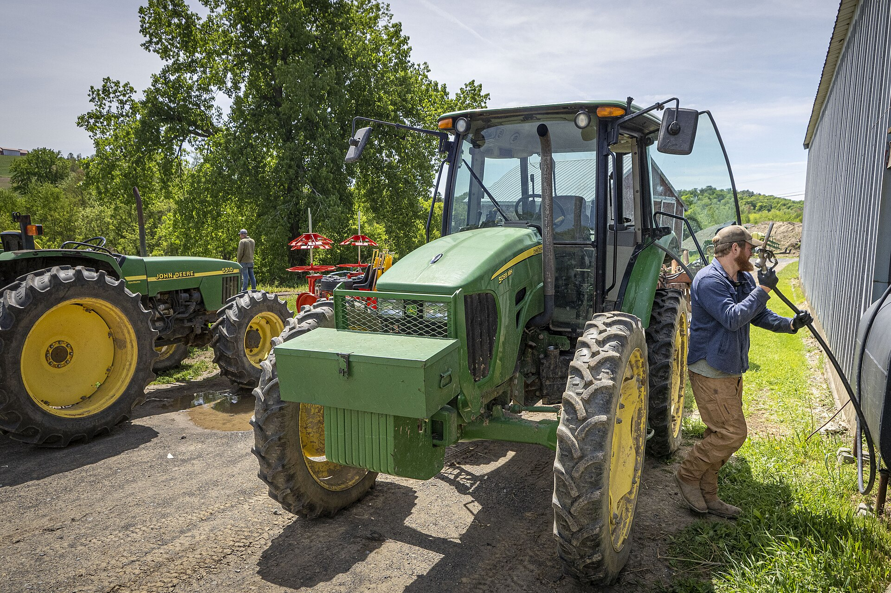

# The Second Job Behind the American Farm

Economics & Evidence

Land & Agriculture

Why do American farmers work outside farming? USDA data show how off-farm earnings protect households without necessarily making their farms profitable.

Author

Elvis Kwame Ofori

Published

21 October 2026

Will Morningstar refuels a tractor at a vegetable farm in Hudson, New York.

*Photograph: Preston Keres, USDA Farm Production and Conservation, 18 May 2022. [Original file and public-domain information](https://commons.wikimedia.org/wiki/File:20220518-FPAC-PJK-0912_TONED.jpg). Used for editorial illustration; no USDA endorsement is implied. The photograph does not depict a person identified here as having a second job.*

There is something about farming that we rarely see in the photographs. We see the fields, the machinery, the harvest and occasionally the farmer standing proudly beside what months of work have produced. What we do not always see is the other job that helps keep the farm running.

A farmer may spend the morning tending livestock before leaving for work elsewhere. A spouse may earn a salary that pays the household bills while the farm struggles through another difficult season. In some households, it is not the farm that supports the family, but the family that financially supports the farm.

This is not an unusual arrangement in American agriculture.

According to the [US Department of Agriculture’s September 2026 forecast](https://www.ers.usda.gov/topics/farm-economy/farm-household-well-being/farm-household-income-forecast), median income earned directly from farming among farm-operator households is forecast at **negative \$467** in 2026. Median off-farm income, meanwhile, is forecast at **\$93,975**.

Those figures need care. They are separate medians, not the accounts of one representative household, and they should not simply be added together. American agriculture contains everything from small holdings maintained alongside other occupations to substantial commercial businesses generating significant profits.

Yet they reveal something worth discussing. For many American farming families, earning a living and operating a farm are not quite the same economic activity.

## Why do farmers work outside farming?

We sometimes assume that a farmer taking another job is evidence that the farm has failed. The reality is more complicated.

In [USDA research on off-farm employment](https://www.ers.usda.gov/data-products/charts-of-note/98676), many surveyed small-farm households described more reliable outside income and higher earnings as reasons for working beyond the farm. Healthcare and retirement benefits mattered too. The underlying survey evidence is from 2018, rather than a new 2026 survey.

This makes economic sense. Farm income depends on weather, production costs and prices that a farmer cannot fully control. A regular wage arrives more predictably. It can help a household manage expenses when agricultural income is uncertain and may provide benefits that would otherwise be expensive to obtain.

Off-farm work can therefore be a sensible way of managing risk rather than an admission of failure.

But there is another side to this arrangement.

If a farming business continually relies on wages earned elsewhere to meet its operating expenses, we should ask whether its apparent survival tells us enough about its economic viability. A farm can continue producing while its owners absorb financial pressure through longer working hours, household savings or income earned outside agriculture.

The distinction matters because the same arrangement can have very different meanings across farms.

[USDA’s farm-household statistics](https://www.ers.usda.gov/data-products/farm-household-income-and-characteristics) show that commercial family farms and smaller operations have markedly different sources of household income. In 2024, median farm income among commercial farm households was approximately **\$175,000**, compared with roughly **negative \$2,800** for intermediate farm households.

The first group generally operates farming as a substantial commercial enterprise. The second includes smaller businesses whose operators identify farming as their primary occupation. Residence farms, whose operators generally report another primary occupation or retirement, form another category altogether.

It would be a mistake to treat every small farm’s negative accounting income as evidence of hardship. Some people farm part-time because they enjoy it, value the land or choose to combine agriculture with another career.

Others may want farming to become their principal livelihood but find that the business cannot yet support them.

A national statistic cannot distinguish those circumstances by itself.

## When household security hides farm insecurity

I find the relationship between household income and farm income particularly interesting.

An American farming household may be reasonably comfortable financially because someone earns a good salary elsewhere. That is important for the family’s welfare. But it does not establish that the farm generates adequate returns to labour, land and capital.

Imagine a small farmer who finishes a demanding day on the farm and then works evenings elsewhere. The household may remain financially secure, while the farming business continues to generate little income.

Another family might deliberately arrange the same division of labour because it allows them to maintain a small farm alongside rewarding employment. The financial outcomes may appear similar, but their economic circumstances and ambitions differ.

This makes the question of farmers’ welfare more demanding than looking at annual farm profits or total household income.

We need to understand whether off-farm earnings are supporting a preferred way of life, helping a growing agricultural business through its early years, or compensating for persistent financial difficulties.

We should also consider the implications for the next generation. A young person hoping to farm commercially may face land costs, machinery investment and access-to-credit requirements that cannot easily be managed alongside another full-time job. A household’s ability to subsidise farming with outside earnings may sustain an existing operation without providing a realistic entry route for someone starting from nothing.

There are no simple policy answers. Higher subsidies are not automatically the solution, particularly if some benefits eventually become reflected in land prices and rents. Equally, dismissing farms that depend on off-farm employment overlooks the variety of economic and social contributions made by smaller agricultural businesses.

What interests me is the possibility that American agricultural policy pays considerable attention to farm production without always distinguishing it from the financial security of farming households.

The two are related, but they are not identical.

We often celebrate the resilience of farming families. There is good reason to admire the work involved. But resilience should not prevent us from asking what makes that work financially sustainable.

**The second job behind the American farm can be a source of independence and security. It can also be a sign that the farm alone cannot provide the livelihood its operators hope to earn. Understanding the difference is where a more serious conversation about farmers’ welfare should begin.**

### Sources and further reading

- [USDA Economic Research Service. Farm Household Income Forecast](https://www.ers.usda.gov/topics/farm-economy/farm-household-well-being/farm-household-income-forecast).
- [USDA Economic Research Service. Farm Household Income and Characteristics](https://www.ers.usda.gov/data-products/farm-household-income-and-characteristics).
- [USDA Economic Research Service. Off-farm employment motivations, Charts of Note (2020)](https://www.ers.usda.gov/data-products/charts-of-note/98676).
- [USDA Economic Research Service. America’s Farms and Ranches at a Glance](https://www.ers.usda.gov/publications).
