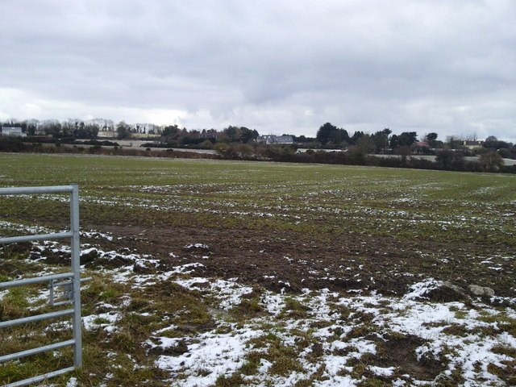

{fig-alt="Agricultural fields in County Dublin. A general landscape photograph, not an image of the BioScale 2030 summit." width="100%" fig-align="center"}

*Photograph: [C O'Flanagan / Wikimedia Commons](https://commons.wikimedia.org/wiki/File:Agricultural_Landscape_Co_Dublin_-_geograph.org.uk_-_1721182.jpg), [CC BY-SA 2.0](https://creativecommons.org/licenses/by-sa/2.0/). General agricultural landscape illustration; not a BioScale 2030 event photograph.*

Ireland launched its first National Bioeconomy Strategy in Dublin on Wednesday, setting out plans to turn renewable biological resources and scientific innovation into new businesses, products and employment opportunities. The strategy, known as *BioScale 2030*, was unveiled at the [Global Bioeconomy Summit](https://www.cbe.europa.eu/events/global-bioeconomy-summit-2026) by Taoiseach Micheál Martin and Ministers Martin Heydon and Darragh O'Brien.

The strategy builds on Ireland's strengths in agriculture, food production, forestry, marine resources and biotechnology. Its purpose is to encourage greater use of biological materials in manufacturing and to develop products that can replace some of those currently derived from fossil resources. New food ingredients, animal feeds, biological fertilisers, construction materials and industrial products are among the opportunities identified in the [government's bioeconomy policy programme](https://www.gov.ie/en/department-of-agriculture-food-and-the-marine/publications/the-bioeconomy/).

The idea is not entirely new. Ireland adopted a [National Policy Statement on the Bioeconomy in 2018](https://www.gov.ie/en/department-of-agriculture-food-and-the-marine/publications/bioeconomy-policy/) and subsequently introduced an action plan covering 2023 to 2025. Research institutions and businesses have since developed new processes for recovering valuable materials from agricultural and food-processing residues. BioScale 2030 is intended to build on that work by bringing research, investment and industrial development into a more coordinated national programme.

Some of these opportunities are already taking shape. At Shinagh in Cork, a demonstration facility combines grass biorefining with anaerobic digestion, exploring how grass can supply several useful products rather than serving only as conventional animal feed. The National Biorefinery Pilot Plant at Lisheen in Tipperary provides infrastructure for developing and testing biological processing technologies. Irish businesses are also finding commercial uses for materials once considered waste. BiaSol produces food ingredients from spent brewing grain, while MEDITE SMARTPLY is exploring further applications for residues from wood-based manufacturing. These examples were highlighted in the [21 October strategy launch](https://www.gov.ie/en/department-of-agriculture-food-and-the-marine/publications/the-bioeconomy/).

These developments illustrate how the bioeconomy can create value from resources that Ireland already produces. They also demonstrate the importance of bringing different industries together. Biological materials generated in agriculture or food processing may become inputs for other businesses, creating new relationships between farmers, processors, manufacturers and research institutions.

Research, however, is only one part of developing a successful bioeconomy. New technologies must be able to operate commercially, attract investment and find dependable markets. Processing agricultural biomass can involve significant costs for collection, storage and transport, particularly when materials are bulky or contain large amounts of water. Businesses must also demonstrate that their products meet appropriate standards and can compete with existing alternatives.

BioScale 2030 proposes action in these areas through investment in pilot and commercial-scale infrastructure, improved access to finance, skills development, regulatory coordination and measures to strengthen demand for biobased products. The strategy also identifies opportunities in circular nutrients, construction, marine resources, industrial biomaterials and organic waste recovery.

For farmers, foresters and fishing communities, the development of these industries could provide new sources of income. Agricultural residues, grass and other biological resources may gain additional commercial uses, while regional processing facilities could create employment outside Ireland's larger urban centres. The benefits will depend on the markets that develop, the costs of supplying materials and the arrangements between primary producers and processing businesses.

Sustainability will be equally important. Biological resources are renewable when appropriately managed, but their supply is not unlimited. Using agricultural materials for industrial production must be considered alongside existing demands for food, feed, soil health and environmental protection.

Ireland has already established a substantial research and demonstration base. BioScale 2030 now provides a national framework for taking the next step. Its progress towards 2030 will become clearer as new technologies enter commercial production, businesses establish reliable markets and more of the economic value generated reaches the regions supplying the resources.
