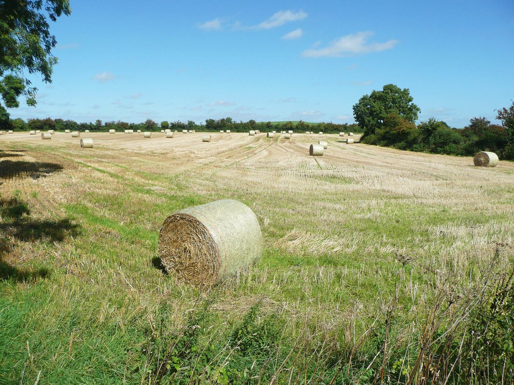

{fig-alt="A wide harvested field of pale stubble with dozens of round bales scattered across it, a large bale in the foreground, hedgerows and trees along the far edge and a blue sky with light cloud." width="100%" fig-align="center"}

*Photograph: [Humphrey Bolton / Wikimedia Commons](https://commons.wikimedia.org/wiki/File:Hay_Bales_in_Carlow.jpg), [CC BY-SA 2.0](https://creativecommons.org/licenses/by-sa/2.0/).*

On 26 October, agriculture ministers meeting under the Irish presidency of the Council of the EU agreed their [negotiating position on the post-2027 Common Agricultural Policy](https://www.consilium.europa.eu/en/press/press-releases/2026/10/26/mff-2028-2034-council-secures-negotiating-position-for-a-strong-and-future-oriented-common-agricultural-policy/). Martin Heydon, who chaired the meeting as Ireland's agriculture minister, called it a major milestone for the presidency. Earlier the same month the Government, also wearing its presidency hat, had put forward a compromise proposing €141 billion in cuts to the EU's next long-term budget. On 13 November about 200 farmers came to Dublin by bus and [protested at Grand Canal](https://www.thejournal.ie/dublin-ifa-protest-today-7223613-Nov2026/), a short walk from the Convention Centre where EU leaders were meeting. The Irish Farmers' Association warned that a 24 per cent cut to the CAP budget could mean a 24 per cent cut in payments to farmers.

The last time Ireland held the presidency, in the first half of 2013, it also closed a CAP deal. Alan Matthews of Trinity College Dublin summed it up on his blog in a title that is worth borrowing as a question for this autumn: ["A triumph for the Irish Presidency – a damp squib for CAP reform"](https://capreform.eu/a-triumph-for-the-irish-presidency-a-damp-squib-for-cap-reform/). A presidency can succeed at brokering agreement while the agreement itself does little. This time the risk runs the other way. The presidency may well get its deal, and the deal may be the one that shrinks the CAP.

## What was agreed, and what was not

The October agreement is a "partial" position, and the word matters. The Council itself says it [does not cover financial and horizontal issues](https://www.consilium.europa.eu/en/press/press-releases/2026/10/26/mff-2028-2034-council-secures-negotiating-position-for-a-strong-and-future-oriented-common-agricultural-policy/), which are being negotiated with the rest of the 2028 to 2034 budget. Ministers settled the architecture. Under the Commission's proposal, the two CAP funds for direct payments and rural development would merge, and the money would sit inside a single national and regional partnership plan for each member state, alongside cohesion, fisheries and migration funding. Income support would become a degressive area-based payment, with a mandatory definition of an active farmer and a higher rate for young farmers.

What ministers did not settle is how much money there will be, how it is divided between countries, and how far payments to large farms are reduced or capped. The press release says plainly that the rules on degressivity and capping, and the final amount ringfenced for farmers, will be decided in the overall budget negotiations. Everything that determines what arrives in an Irish farmer's account is still open.

This is close to where things stood in June 2013. Matthews noted then that the questions most important to farmers, including the national envelopes, transfers between the two pillars, co-financing rates and capping, could not be settled in the CAP talks because they belonged to the budget negotiations running alongside. The institutions have changed the plumbing since. They have not changed the order in which the decisions get made.

## How big is the cut?

The 24 per cent figure is real but needs reading carefully. It comes from comparing the [€295.7 billion the Commission proposed to ringfence](https://capreform.eu/the-commissions-cap-budget-proposal-in-the-next-mff/) for CAP income support and fisheries over 2028 to 2034 with the €387.8 billion available for the whole CAP in 2021 to 2027, both in current prices. Matthews made that comparison when the proposal was published in July 2025, and then made a fairer one. The ringfenced pot is meant to pay for income support. Rural development measures such as investment grants, cooperation projects and advisory services would come out of the wider national plans. Comparing like with like, he estimated the reduction in the nominal income support budget at about 15 per cent. In real terms, after seven years of inflation, it would be larger.

So the IFA's warning that a 24 per cent cut means 24 per cent less in payments overstates the cut to the money that pays farmers directly, at least on the Commission's own numbers. But there is also a reason it may understate what farmers feel. The ringfenced figure is a minimum. Member states could add to it from their national plans, but those plans also have to fund regional development, migration and everything else the old separate funds paid for. Matthews judged additional national top-ups to be possible but ["rather unlikely"](https://capreform.eu/which-countries-gain-or-lose-from-the-national-and-regional-partnership-fund/). Rural development schemes that depend on that wider pot would then compete with roads and hospitals for the same money.

For a sense of scale in Ireland, the [current CAP Strategic Plan](https://www.gov.ie/en/department-of-agriculture-food-and-the-marine/press-releases/mcconalogue-announces-overall-cap-strategic-plan-funding-and-indicative-allocations-for-pillar-ii-rural-development-measures/) is worth €9.8 billion over 2023 to 2027, of which €7.5 billion comes from the EU and €2.3 billion from the Exchequer. Direct payments and sectoral support under Pillar I account for roughly €1.2 billion a year. Purely as an illustration, if that money fell by the 15 per cent Matthews estimated for the EU as a whole, Irish farmers would receive something like €180 million a year less in nominal terms. The actual figure depends on Ireland's share of the ringfenced amount, which has not been published, and on whether the final budget keeps the Commission's number at all.

## Two hats

IFA president Francie Gorman told The Journal that the Taoiseach had promised the Government "would not countenance a weakened CAP budget", and that Ireland gets about 75 per cent of what it receives from the EU through the CAP. Both points explain why Irish governments defend the CAP harder than almost anyone. But a presidency is not a delegation. Its job is to find a figure 27 governments can accept, and several of them want the overall budget smaller still. Ireland's own €141 billion compromise was, in the words of the European affairs minister, intended to bridge differences between member states. Bridging them means proposing less than the Commission asked for.

I think the honest reading is that Ireland cannot fully play both roles at once, and that the presidency's success will be measured by whether a budget is agreed, not by the size of the CAP inside it. In 2013 that tension was eased because the European Council had already fixed the budget ceilings in February, before the decisive CAP negotiations with the Parliament began in the spring. This time the budget and the CAP are being negotiated in the same autumn, under the same presidency.

## What a reform this is

Set the money aside and the redesign is significant. Matthews' 2013 verdict was that the reform offered minor fine-tuning in return for more national flexibility and more administrative complexity. The 2028 proposal goes much further on flexibility: one plan per country, one fund, and national choices over how to define an active farmer, how hard to redistribute towards smaller farms and whether to add money from elsewhere in the plan. For Irish farmers, that means the decisions made in Dublin after the Brussels deal will matter almost as much as the deal itself. A smaller ringfence spent with more targeting could leave some farms better off and many worse off.

## Still to come

The overall budget needs unanimous agreement among member states and the consent of the European Parliament, and the CAP regulation then has to be agreed with the Parliament in its own right. Ireland's presidency ends on 31 December. Whatever figure it manages to broker will set the limits for the CAP that follows, and the national allocations that would tell an Irish farmer what to expect have not yet been published. The number on the farmers' banners is a warning, not yet a payment.


