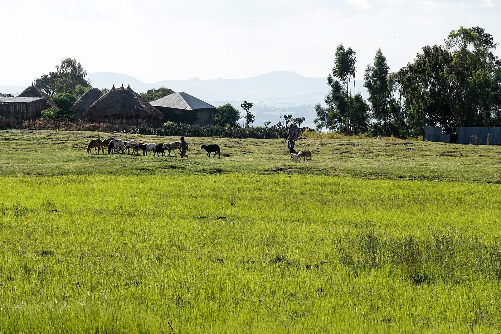
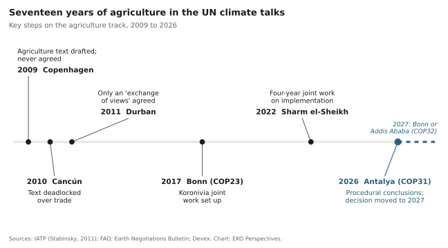

{fig-alt="A wide green field of young teff fills the foreground. Behind it, two people walk a small flock of sheep across grazing land past thatched round houses, a tin-roofed building and tall eucalyptus trees, with hazy hills on the horizon." width="100%" fig-align="center"}

*Photograph: [Timothy A. Gonsalves / Wikimedia Commons](https://commons.wikimedia.org/wiki/File:Teff_Village_Oromia_Ethiopia_Oct19_R16_02202.jpg), [CC BY-SA 4.0](https://creativecommons.org/licenses/by-sa/4.0/).*

Nobody at a climate summit disputes that farming matters. Agriculture, forestry and other land use produced about 22 per cent of global net greenhouse gas emissions in 2019, [according to the IPCC](https://www.ipcc.ch/report/ar6/wg3/chapter/summary-for-policymakers/). In the national adaptation plans of 64 developing countries, agrifood systems account for 54 per cent of the adaptation finance those countries say they need, [FAO and UNDP found](https://www.fao.org/newsroom/detail/cop30--landmark-report-finds-countries--climate-agrifood-ambitions-undermined-by-funding-gaps/en). The disagreement has always been about something else: what the UN climate regime should actually do about agriculture. At COP31 in Antalya, countries failed to settle that again.

The vehicle this time was the Sharm el-Sheikh joint work on agriculture and food security, a four-year programme created at COP27 in 2022 and due to finish in Antalya with a decision on what came next. It did not finish. When the subsidiary bodies closed, the co-facilitator invited views on [draft procedural conclusions](https://enb.iisd.org/antalya-un-climate-change-conference-cop31-daily-report-14nov2026), the kind that record a discussion without deciding anything, and several parties said they were disappointed. The substantive decision now waits until 2027, either at the June talks in Bonn or at COP32 in Addis Ababa, [Devex reported](https://www.devex.com/news/cop31-stalls-on-agriculture-leaving-food-talks-in-limbo-until-2027-113897). Carbon Brief described a text [full of political red lines](https://www.carbonbrief.org/cropped-18-november-2026-cop31-special-edition), including trade measures and adaptation finance.

How can a subject everyone agrees is important be this hard to agree on? I went back to the last time the answer was written down clearly. In December 2011, Doreen Stabinsky of the Institute for Agriculture and Trade Policy explained [what had happened to agriculture at Durban](https://www.iatp.org/blog/201112/deal-durban-what-happened-agriculture-climate-talks). A negotiating text on agriculture had been circulating since before the 2009 Copenhagen summit, barely changed in two years. Two things kept it stuck. The first was where it sat: agriculture was being negotiated in a mitigation workstream, while most developing countries saw farming mainly as a problem of adapting to climate impacts and saw no reason to agree on cutting farm emissions. The second was trade. Argentina and Brazil insisted on language saying that nothing agreed could be used to create barriers to trade; New Zealand, the United States and others refused it. Cancún ended in deadlock. Durban produced no work programme, only an agreement to exchange views at the next technical session.

{fig-alt="Timeline of agriculture in the UN climate talks. 2009 Copenhagen: agriculture text drafted but never agreed. 2010 Cancún: text deadlocked over trade. 2011 Durban: only an exchange of views agreed. 2017 Bonn, COP23: Koronivia joint work set up. 2022 Sharm el-Sheikh: four-year joint work on implementation. 2026 Antalya, COP31: procedural conclusions, with the decision moved to 2027 in Bonn or at COP32 in Addis Ababa." width="100%" fig-align="center"}

*Original chart for EKO Perspectives. Sources: [IATP](https://www.iatp.org/blog/201112/deal-durban-what-happened-agriculture-climate-talks), [FAO](https://www.fao.org/climate-change/what-we-do/unfccc-processes/sharm-el-sheikh-joint-work/en), [Earth Negotiations Bulletin](https://enb.iisd.org/antalya-un-climate-change-conference-cop31-daily-report-14nov2026), [Devex](https://www.devex.com/news/cop31-stalls-on-agriculture-leaving-food-talks-in-limbo-until-2027-113897).*

Read next to the reporting from Antalya, the old account works almost as a description of this year.

## The trade argument came back

In 2011 the trade fight was hypothetical. Exporters worried that climate rules on farming could one day be turned into barriers against their products. In 2026 the measures exist. The EU's carbon border adjustment mechanism prices the carbon in some imports, and its deforestation regulation will require [cocoa, coffee, soy, cattle and other commodities](/blog/posts/2026-10-05-eudr-cocoa-ghana/) to be traced to land not cleared since 2020. Developing countries have spent several summits trying to get "unilateral trade measures" onto the agenda. A presidency draft of the Antalya cover decision [expressed serious concern](https://www.dhakatribune.com/world/europe/424860/cop31-draft-proposes-120bn-adaptation-finance) about their spread and called on developed countries to phase them out by the end of 2027, though that was a draft, not an agreed outcome. In the parallel talks on a just transition, the Arab Group and Nigeria [raised the negative impacts](https://enb.iisd.org/antalya-un-climate-change-conference-cop31-daily-report-16nov2026) of unilateral trade measures. Teresa Anderson of ActionAid told Carbon Brief that bringing trade measures into the agriculture text "railroaded the whole thing".

The difference from 2011 is that the side worried about trade now has something concrete to object to, and agriculture is where those measures bite. Cocoa, soy and beef are farm products. A decision on agriculture is the obvious place to fight about them, which also makes it an easy decision to block.

## The scope argument came back with new words

The second old argument, about what agriculture is for in the climate regime, has also returned under different labels. In 2011 the line ran between mitigation and adaptation. In Antalya it ran between "agriculture" and "food systems". In the just transition talks, the African Group, the Arab Group and the small island states [opposed references](https://enb.iisd.org/antalya-un-climate-change-conference-cop31-daily-report-16nov2026) to a just transition in "food systems" and preferred "agriculture", while the EU and the Environmental Integrity Group supported the broader food systems approach.

I read this as the same dispute in new vocabulary. "Food systems" reaches past the farm gate into processing, trade, diets and consumption, and it brings the whole chain closer to emissions targets. "Agriculture" keeps the subject on producers, food security and adaptation, which is where most developing countries have always wanted it. Neither word is wrong. But the choice decides who is expected to change, and that is why it gets fought over. When Carbon Brief checked the first draft of the summit's cover text, the phrase "food systems" [did not appear in it at all](https://www.carbonbrief.org/cropped-18-november-2026-cop31-special-edition). Oceans were mentioned 21 times.

## What a decision would have been worth

Stabinsky's question in 2011 was why some governments wanted an agriculture decision so badly. Her answer was that a formal work programme could validate methods for counting carbon in farm soils and so support agricultural carbon markets. The equivalent question now is about money. The same FAO and UNDP analysis found that agrifood systems receive about 20 per cent of adaptation finance, against 54 per cent of the need, and roughly one per cent of total climate finance. For countries whose farmers are already absorbing droughts and floods, an agriculture decision is worth having if it moves that number. For countries expected to pay, a decision that names finance obligations is the thing to avoid. Carbon Brief's account does not say which countries held the adaptation finance line, and I do not want to guess. The shape of the problem is visible without that.

So my reading is that the agriculture track fails not because farming is technically difficult to discuss but because it is the one place in the climate regime where trade, finance and responsibility for food emissions all meet. Any party with a red line on any one of them can stop the whole thing, and under consensus rules one is enough.

## What happened in the end

What Antalya produced was procedure. The subsidiary bodies adopted conclusions forwarding a draft decision, which the COP then adopted, with the real choices left for 2027. The EU, supported by Brazil, proposed a ["friends of progress" group](https://enb.iisd.org/antalya-un-climate-change-conference-cop31-daily-report-14nov2026) to explore how to move the work forward. The farmers' constituency told the closing session it felt left behind.

The work on agriculture did not stop. It moved outside the negotiations. FAO launched a [turquoise nexus initiative](https://www.carbonbrief.org/cropped-18-november-2026-cop31-special-edition) linking food security, water and climate action. Ethiopia, next year's host, joined the Alliance of Champions for Food Systems Transformation. Seven of the 159 countries in the Global Methane Pledge reaffirmed their target of a 30 per cent cut by 2030. None of these needed consensus, which is why they could happen in a fortnight. None of them carries an obligation either, which is why they do not answer the question the agriculture track was built to answer. Stabinsky made the same observation in 2011: the people driving the agriculture agenda did not need a UN decision to pursue it. That is still true. What still lacks a forum with any authority is the farmer who needs the adaptation money.

The decision now goes to Addis Ababa, the first African COP since Sharm el-Sheikh. It will meet the two arguments that have been in the room since Copenhagen, and the same gap between 54 per cent of the need and 20 per cent of the money.


