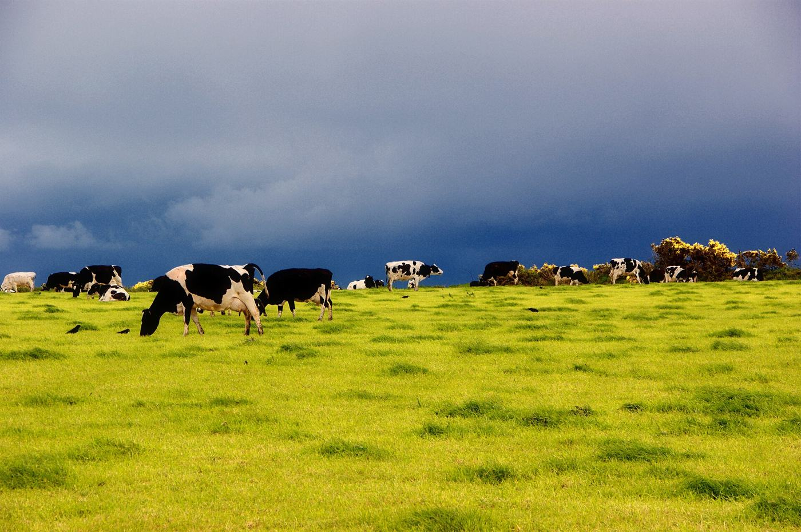
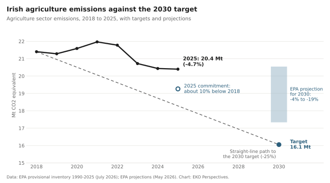

{fig-alt="A herd of black and white Friesian dairy cows grazing on a bright green, tufted pasture, with yellow-flowering gorse on the skyline and a dark blue storm sky above." width="100%" fig-align="center"}

*Photograph: [Martin Abegglen / Wikimedia Commons](https://commons.wikimedia.org/wiki/File:Dairy_cows_on_pasture_in_Ireland.jpg), [CC BY-SA 2.0](https://creativecommons.org/licenses/by-sa/2.0/).*

The figures for Irish agriculture in 2025 tell a small story that explains a large one. Emissions from the sector fell by 0.2 per cent, to 20.4 million tonnes of carbon dioxide equivalent, according to the [EPA's provisional inventory](https://www.epa.ie/publications/monitoring--assessment/climate-change/air-emissions/irelands-provisional-greenhouse-gas-emissions-1990-2025.php) published in July. The number of cattle fell by 3.3 per cent, which on its own would have produced a real cut. But nitrogen fertiliser use rose by 12.7 per cent, to almost 350,000 tonnes, and milk output rose by 4.8 per cent. The cattle took emissions out, the fertiliser put most of them back, and the sector, which produces 38.7 per cent of the country's emissions, ended the year almost exactly where it started.

In September the Climate Change Advisory Council put the result in context. Agriculture emissions are now [4.7 per cent below 2018](https://www.climatecouncil.ie/news/press-release-annual-review-2026---agriculture-and-land-use-land-use-change-and-forestry.html), less than half the 10 per cent reduction the Government committed to for 2025. The legal target for 2030 is 25 per cent. With five years gone and five left, the sector has covered less than a fifth of the distance.

This is close to my own research, which asks which farms and places end up carrying targets like this one. Nothing below draws on unpublished work. Every figure comes from the EPA or the Council.

## The 2025 commitment

{fig-alt="Line chart of Irish agriculture emissions from 2018 to 2025. Emissions start at 21.4 million tonnes in 2018, rise to 22.0 in 2021, then fall to 20.4 in 2025, 4.7 per cent below 2018. A dashed straight line runs from 21.4 in 2018 to the 2030 target of 16.1 million tonnes, 25 per cent lower. The 2025 commitment of about 10 per cent below 2018 is marked at about 19.3 million tonnes, well below the actual figure. A shaded bar shows the EPA's 2030 projection range of 4 to 19 per cent below 2018." width="100%" fig-align="center"}

*Original chart for EKO Perspectives. Data: EPA [provisional inventory 1990-2025](https://www.epa.ie/publications/monitoring--assessment/climate-change/air-emissions/irelands-provisional-greenhouse-gas-emissions-1990-2025.php) and [projections (May 2026)](https://www.epa.ie/news-releases/news-releases-2026/epa-projections-show-ireland-remains-off-track-for-2030-climate-.php).*

The chart shows the shape of the problem. Emissions rose after 2018, peaked at 22.0 million tonnes in 2021, and have fallen since 2022, helped by lower fertiliser use after prices spiked that year. A straight line from 2018 to the 2030 target would have put the sector at about 18.3 million tonnes in 2025, and even the softer 2025 commitment meant about 19.3. It reached 20.4.

There is a complication worth understanding, because it changes how the sector's record looks on paper. Agriculture was given a ceiling of 106 million tonnes for the five years from 2021 to 2025. On the EPA's figures it used 105.3, or 99.3 per cent, and so appears to have stayed within its budget. But the EPA itself says a [direct comparison is no longer viable](https://www.epa.ie/publications/monitoring--assessment/climate-change/air-emissions/irelands-provisional-greenhouse-gas-emissions-1990-2025.php). In 2023 the inventory was revised to reflect updated science on agricultural emissions, which lowered the estimates for every year, including the years the ceiling was based on. Improvements to the agriculture and land-use inventories cut estimated emissions over the five-year budget by 12 to 14 million tonnes in total, which the EPA says is what made it possible for the country to stay within its overall carbon budget.

That is a measurement change, not a change on farms. The ceiling was met. The reduction the ceiling was supposed to deliver was not. Percentages measured against a revised 2018 baseline are the better guide, and on that measure the sector is at 4.7 per cent against a commitment of about 10.

## Targets to 2030

The [EPA's projections](https://www.epa.ie/news-releases/news-releases-2026/epa-projections-show-ireland-remains-off-track-for-2030-climate-.php), published in May, put agriculture emissions in 2030 between 4 and 19 per cent below 2018, depending on how much of current policy is implemented. The lower figure is what existing measures deliver. The higher one assumes the measures in government plans are carried out in full. The savings come from three things: less nitrogen fertiliser, a switch to fertilisers that release less nitrous oxide, and fewer animals.

Even the optimistic case misses 25 per cent. The Council's view is that the target remains achievable if the additional diversification measures in the Climate Action Plan, such as forestry and biomethane, are also fully implemented. But it also reports that only 2,527 hectares of new forest were planted in 2025 against a target of 8,000, a gap I [looked at in October](/blog/posts/2026-10-01-ireland-tree-planting-promise/), and that biomethane production is far behind plan. The measures that would close the gap are the ones furthest behind.

The 2025 figures also show how fragile the fertiliser savings are. Fertiliser use fell sharply after the 2022 price spike and then rebounded by 12.7 per cent in a single year once prices eased. A reduction that depends on high prices is not a policy, and the [fertiliser support scheme](/blog/posts/2026-10-18-fertiliser-exceptional-aid/) announced this autumn is a reminder that governments also act to bring prices down when farmers are under pressure.

## What a fair target looks like

The Government chose 25 per cent in 2022, from a range of 22 to 30 per cent set out in the 2021 Climate Action Plan. It was lower than the targets set for most other sectors, and the usual justifications are that methane from cattle is hard to cut without cutting cattle, and that agriculture matters more to the rural economy than its share of national output suggests. I do not think the target itself is the problem. The problem is that, five years in, nobody has said clearly how a 25 per cent cut would be shared out.

That matters because the sector average hides very different farms. A cut in the national herd falls on whoever reduces stock numbers, and the most profitable dairy farms have the least reason to do it. Fertiliser savings depend on farmers changing practice on land they already farm. Forestry and biomethane ask farmers to change what their land is for, often permanently. Each route puts the adjustment on different people, and the EPA's 4 to 19 per cent range is really a measure of how far the State is prepared to go in deciding who that will be.

The Council asked the Department of Agriculture to produce a time-bound, properly resourced plan, shaped through structured dialogue with farmers and rural communities. That is the right request. A target of 25 per cent with no account of who reaches it is a number, not a plan, and the 2025 figures show what a number on its own produces: one good year for cattle, one bad year for fertiliser, and a sector that ends where it began.


