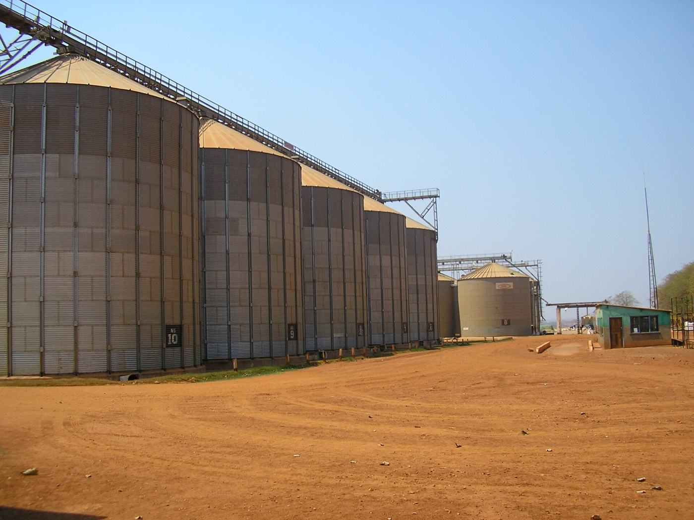

{fig-alt="A row of five tall corrugated steel grain silos with conical roofs and an overhead conveyor, a smaller silo and a green-painted weighbridge office behind, on a wide yard of bare red earth under a clear blue sky." width="100%" fig-align="center"}

*Photograph: [Maxdrobot / Wikimedia Commons](https://commons.wikimedia.org/wiki/File:Grain_Silos_and_weighing_bridge.jpg), public domain.*

Zambia's Food Reserve Agency bought about 2.7 million tonnes of maize in this year's marketing season, more than five times the 500,000 tonnes it had planned to buy. By September its stocks had reached a record 3.1 million tonnes. On 4 November parliament approved a supplementary budget that includes 14.7 billion kwacha, about $725 million, to pay farmers who had sold maize to the state and were still waiting for their money, and the Treasury plans to borrow most of it on the domestic market, [bne IntelliNews reported](https://www.intellinews.com/zambia-counts-cost-of-record-maize-buying-as-southern-africa-s-glut-meets-el-ni-o-threat-482796).

The Government's case is that this is preparation. A strong El Niño is under way, and in southern Africa El Niño usually means drought. GEOGLAM's crop monitor puts the chance of a very strong event at [63 per cent](https://www.cropmonitor.org/special-reports-202606), and calls southern Africa the region of greatest concern because the main maize season, planted from October to December and harvested from April to June 2027, coincides with the event's forecast peak. "We're spending ahead of time so that, come 2027, those expenses will be limited," Finance Minister Situmbeko Musokotwane told parliament.

Next door, Malawi harvested about 3.3 million tonnes this year against national requirements of about 3.5 million, according to its agriculture ministry. It enters the El Niño season already dependent on imports, as it was this year, when it bought Zambian maize under a 200,000-tonne government-to-government deal.

So the region has a surplus in one country, a deficit in the next, and a drought on the way. The obvious reading is that this is how food security is supposed to work. I think it is half right, and the half that is wrong has been studied for a long time.

## What the agency does

The Food Reserve Agency is Zambia's strategic grain reserve and, in practice, its main maize marketing board. It buys from farmers at a single national price, stores the grain, and later sells it at home, exports it, or releases it to millers. Fifteen years ago, Nicole Mason and Robert Myers of Michigan State University set out its effects in a short [policy synthesis for Zambia's Food Security Research Project](https://ageconsearch.umn.edu/record/120766/files/ps_50.pdf). In the 2010/11 season the agency bought 83 per cent of the maize smallholders sold, and in several years spending on it exceeded a quarter of all public spending on agriculture.

Their findings were clear. Since 2002/03 the agency's buying price had consistently been above wholesale market prices in the main producing areas. Between 2003 and 2008 its activities raised average maize prices by 17 to 19 per cent. They also made prices more stable, cutting their variability by about a third. And because the agency bought above the market, it could export only at a loss unless the Treasury covered the difference.

## The price this year

The same pattern is visible in this season's numbers. The agency paid 347 kwacha for a 50 kilogram bag, about $345 a tonne. South African white maize for December delivery closed on 29 October at about $232 a tonne. The two prices are not directly comparable, since one is what the agency paid and the other is a futures price, but the gap of roughly 49 per cent is large. South Africa has its own record crop of 17.7 million tonnes against domestic use of about 12 million, and it competes for the same regional buyers.

The agency has signed export contracts for about 1.5 million tonnes, including 540,000 tonnes to a Kenyan trader at a price to be agreed shipment by shipment. Whether it recovers its costs depends on transport, storage and terms that are not public. The IMF's resident representative has [singled out the agency's purchases](https://www.intellinews.com/zambia-counts-cost-of-record-maize-buying-as-southern-africa-s-glut-meets-el-ni-o-threat-482796) as a source of fiscal slippage, and the Finance Minister has said the agency will get little or no new money for next season's buying.

## Who gains and who pays

Mason and Myers' most important finding was about distribution. Higher and more stable maize prices helped large-scale farmers and a relatively small number of better-off smallholders who sell a lot of maize. They hurt urban consumers and the nearly half of smallholders who buy more maize than they sell. On their evidence, the agency's price effects were regressive.

Nothing in this year's figures suggests that has changed, and some of it now reaches across borders. A Zambian farmer who sold to the agency gained from the high price but waited months for payment. A Zambian household that buys maize meal pays a price propped up by the state's buying. Malawi, if it imports again in 2027, buys from a seller whose costs are well above the regional market. In Zimbabwe, 24 millers in Bulawayo halted operations in August, citing shortages of local maize and a $40-a-tonne levy on imports, even after a large harvest.

## What the surplus is worth

None of this means the stock is wasted. A drought year is exactly when a reserve pays for itself, and 3.1 million tonnes in Zambian silos is a real buffer against a bad 2027 harvest. The question is whether it reaches the people who need it on terms they can afford.

Here the region's record is the problem. Zambia lifted its maize export ban only in April. A [World Bank review of Zambian maize trade policy](https://documents1.worldbank.org/curated/en/099845009122237020/pdf/P1770680cbdc81030a9e4092dc8bf6311f.pdf) found that bans have been imposed after price spikes even in years with good harvests. If El Niño cuts the 2027 crop, Zambian maize prices will rise, and the pressure to close the border will rise with them. The surplus would then protect Zambian consumers, which is a legitimate aim, while Malawi waited on a government-to-government deal negotiated under pressure.

My reading is that southern Africa's food security in 2027 will depend less on how much maize is in storage than on whether the borders stay open when prices rise. A reserve bought at 49 per cent above the regional price is an expensive way to insure one country. An open regional market, with the reserve used to calm prices rather than to replace traders, would insure several. That was the policy argument in Lusaka fifteen years ago, and El Niño is about to test it again.


