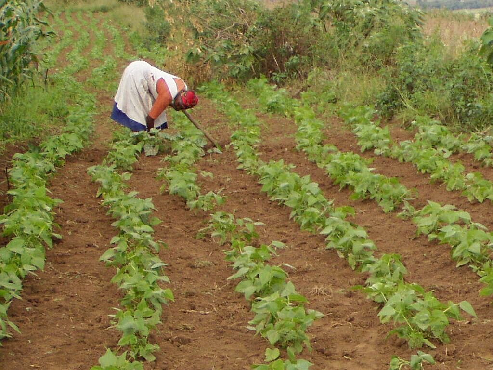
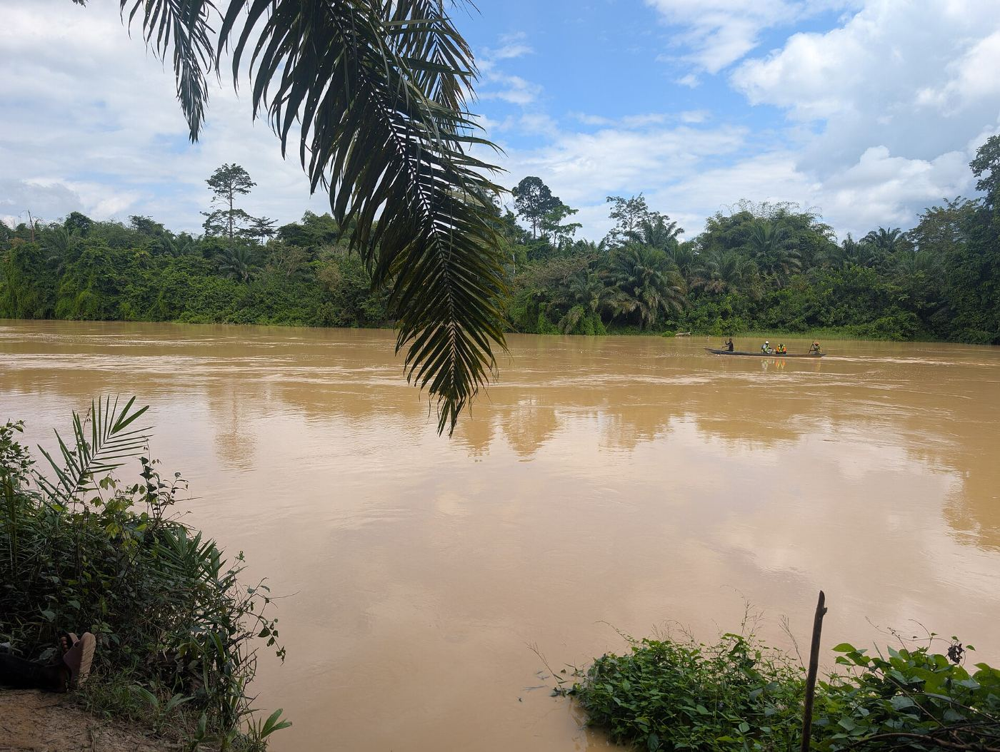
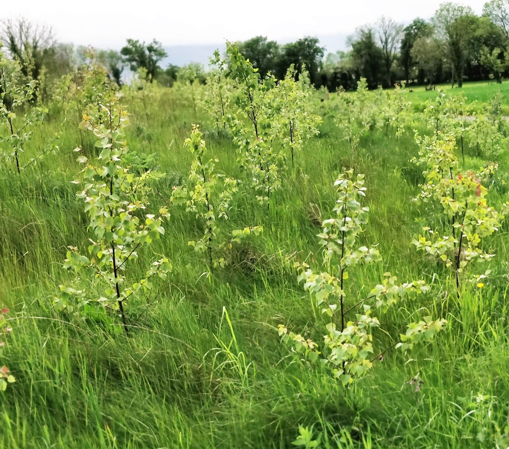

# EKO Perspectives

Research, evidence and ideas on policy, agriculture, land use, economics, science, technology and development.

# [EKO Perspectives](./)

Research, evidence and ideas by Elvis Kwame Ofori

[Policy](./blog/#category=Policy) [Land & Agriculture](./blog/#category=Land%20%26%20Agriculture) [Economics & Evidence](./blog/#category=Economics%20%26%20Evidence) [Science & Technology](./blog/#category=Science%20%26%20Technology) [Places & Development](./blog/#category=Places%20%26%20Development) [Personal & Ideas](./blog/#category=Personal%20%26%20Ideas)

Featured

 Alan Manson · Wikimedia Commons · CC0 1.0

Land & Agriculture

## One hectare, many promises

Climate, biodiversity, energy, housing and food are all asking more of the same land. The farmer who lives from it is rarely at the table.

 Efo Komla · Wikimedia Commons · CC BY-SA 4.0

Places & Development

### We cannot drink gold

Ghana arrests hundreds of illegal miners a year and convicts a handful. The deeper problem is who profits from the gold and who pays for the water.

 Tree Council · Wikimedia Commons · CC BY-SA 4.0

Policy

### Thirty years of Irish tree-planting promises, checked against the record

Ireland has planted a fraction of the forest it promised since 1996. Licensing explains one bad stretch. Farmers walking away from planting explains more of the gap.

## Latest from EKO Perspectives

[All writing →](blog/)

### [The world is protecting more nature. Is it protecting nature better?](blog/posts/2026-10-22-cop17-biodiversity-connectivity/index.llms.md)

At COP17, a new UN assessment exposes the gap between biodiversity pledges and ecological recovery. Why protected areas, connected habitats and working landscapes all matter.

Oct 22, 2026

Elvis Kwame Ofori

### [America feeds its people. But who is looking after its farmers?](blog/posts/2026-10-21-american-farmers-livelihoods/index.llms.md)

The US spends billions on farm relief, yet farming households face very different margins and risks. What should agricultural assistance actually protect?

Oct 21, 2026

Elvis Kwame Ofori

### [The Second Job Behind the American Farm](blog/posts/2026-10-21-why-american-farmers-work-off-farm/index.llms.md)

Why do American farmers work outside farming? USDA data show how off-farm earnings protect households without necessarily making their farms profitable.

Oct 21, 2026

Elvis Kwame Ofori

## About my research

[Research →](research/)

My research examines how national agricultural, climate and land-use goals translate into different costs, opportunities and constraints across farms and places. I work with spatial, economic and behavioural models at the University of Galway.
