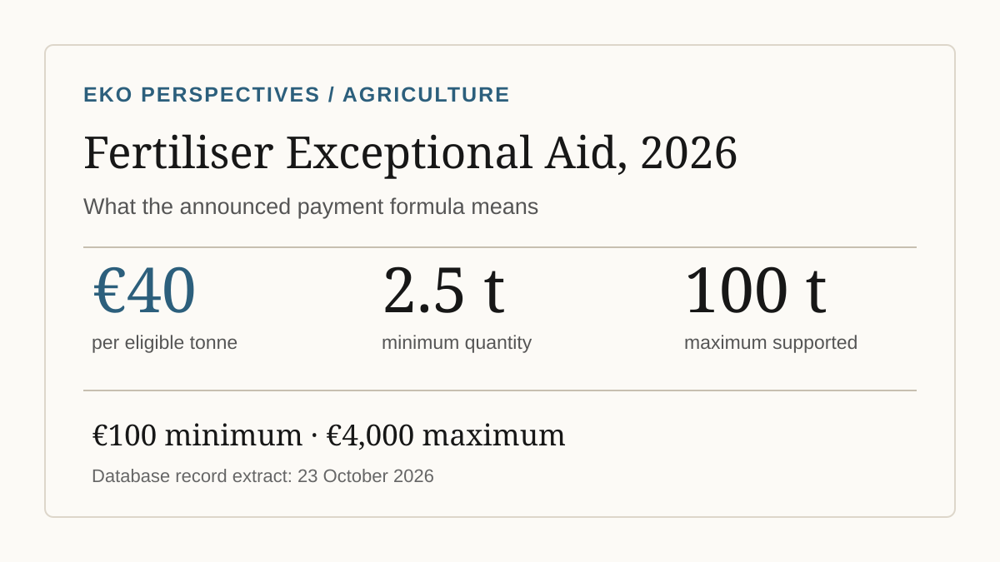
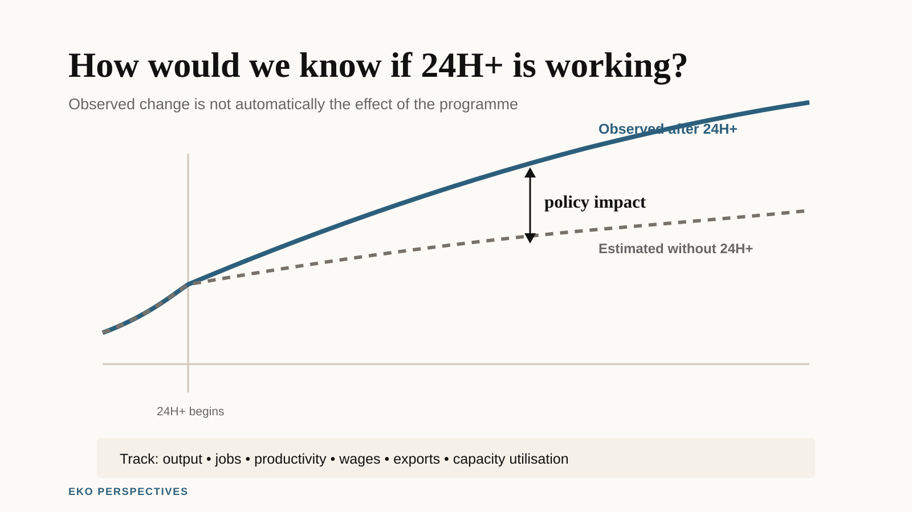

# EKO Perspectives

Research, evidence and ideas on policy, agriculture, land use, economics, science, technology and development.

# [EKO Perspectives](./)

Research, evidence and ideas by Elvis Kwame Ofori

[Policy](./blog/#category=Policy) [Land & Agriculture](./blog/#category=Land%20%26%20Agriculture) [Economics & Evidence](./blog/#category=Economics%20%26%20Evidence) [Science & Technology](./blog/#category=Science%20%26%20Technology) [Places & Development](./blog/#category=Places%20%26%20Development) [Personal & Ideas](./blog/#category=Personal%20%26%20Ideas)

Featured

 Alan Manson · Wikimedia Commons · CC0 1.0

Land & Agriculture

## One hectare, many promises

Climate, biodiversity, energy, housing and food are all asking more of the same land. The farmer who lives from it is rarely at the table.

 Efo Komla · Wikimedia Commons · CC BY-SA 4.0

Places & Development

### We cannot drink gold

Ghana arrests hundreds of illegal miners a year and convicts a handful. The deeper problem is who profits from the gold and who pays for the water.

 Tree Council · Wikimedia Commons · CC BY-SA 4.0

Policy

### Thirty years of Irish tree-planting promises, checked against the record

Ireland has planted a fraction of the forest it promised since 1996. Licensing explains one bad stretch. Farmers walking away from planting explains more of the gap.

## Latest from EKO Perspectives

[All writing →](blog/)

### [Trump’s \$8 billion farm relief plan: why farmers need more than another payment](blog/posts/2026-10-20-us-farm-relief-harvest-fuel/index.llms.md)

USDA has announced \$8 billion in Harvest Fuel Relief, following \$12 billion in earlier farm assistance. How will payments work, who benefits, and what problems remain?

Oct 20, 2026

Elvis Kwame Ofori

### [Ireland’s fertiliser support scheme 2026: who qualifies and how much will farmers get?](blog/posts/2026-10-18-fertiliser-exceptional-aid/index.llms.md)

The 2026 Fertiliser Exceptional Aid Scheme pays €40 per eligible tonne, with records checked on 23 October. Who qualifies, what could you receive, and what does the formula reward?

Oct 18, 2026

Elvis Kwame Ofori

### [Ghana’s 24-hour economy: how would we know if it’s working?](blog/posts/2026-10-12-ghana-24-hour-economy-counterfactual/index.llms.md)

Ghana’s 24-hour economy aims to create 1.7 million jobs by 2028 by using existing capital, labour and infrastructure more intensively. Knowing whether it works requires a counterfactual: what would have happened without it?

Oct 12, 2026

Elvis Kwame Ofori

## About my research

[Research →](research/)

My research examines how national agricultural, climate and land-use goals translate into different costs, opportunities and constraints across farms and places. I work with spatial, economic and behavioural models at the University of Galway.
